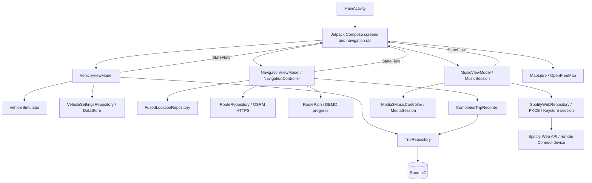

# AutoHMI — Android Automotive Infotainment Simulator

AutoHMI is an Android Automotive infotainment prototype built with **Kotlin and Jetpack Compose**. It combines route planning, driving simulation, an electric-vehicle dashboard and music controls in an adaptive automotive interface.

The first milestone focuses on **Navigation and Driving Simulation**: plan a road route, simulate a drive, pause/resume, and save the completed trip.


*Navigation DEMO on an Android Automotive emulator: a Berlin road route, a 30 km/h speedometer, and distance/ETA visible with the sidebar collapsed. The cyan simulated vehicle is separate from the blue device-location marker.*

[Navigation](#navigation-showcase) · [Architecture](#architecture) · [Verification](#testing-and-verification) · [Setup](#setup) · [Roadmap](#roadmap)

## Navigation showcase

- **Interactive maps:** MapLibre with dark/light OpenFreeMap styles, gestures, zoom buttons, Follow Location, Recenter and Overview.
- **GPS and routing:** foreground Fused Location, long-press or coordinate destinations, OSRM road geometry, driving distance and estimated duration.
- **Driving endpoints:** the selected destination and snapped road endpoint remain distinct. Gaps over 25 m are marked and explained; the gap is excluded from the driving route.
- **DEMO driving:** the cyan marker follows route geometry at 30 km/h, updating distance, ETA and progress. Pause retains position, resume continues, and arrival shows zero remaining driving distance.
- **Adaptive navigation UI:** a swipeable sidebar, compact trip information when collapsed, retained camera/zoom, and a circular DEMO/GPS speedometer drawn with Compose Canvas, inspired by the Hyundai IONIQ 5 cluster.
- **Completed-trip History:** Room stores each completed DEMO once, with duration, distance, average speed, completion time and endpoint-gap details, separately from vehicle snapshots.

| Road-route planning · dark theme                                                                                                       | Running DEMO · expanded sidebar                                                                                                  |
| -------------------------------------------------------------------------------------------------------------------------------------- | -------------------------------------------------------------------------------------------------------------------------------- |
|  |  |
| OSRM road geometry, distance/duration, selected destination and explicit DEMO action.                                                  | Route progress and the speedometer update independently of device GPS.                                                           |

| Pause and resume | Driving-endpoint arrival |
| --- | --- |
|  |  |
| The last position is retained. ETA is suppressed while paused; Exit DEMO is a separate action. | The completed state persists until Exit DEMO or a new route. Reaching the road endpoint does not imply reaching an inaccessible selected point. |

### Saved DEMO trips


*Completed DEMO trips, newest first. Each card shows distance, simulated duration, average speed and completion time; the third card explains a gap between the road endpoint and selected destination.*

### Navigation Demo

[**Watch the Navigation DEMO — arrival and Exit DEMO**](docs/portofolio-media/navigation/recordings/Screen_recording_20261126_170404.webm)

This eight-second recording shows the completed drive, zero remaining distance, and Exit DEMO returning the screen to a ready route.

Maps: [MapLibre](https://maplibre.org/) / [OpenFreeMap](https://openfreemap.org/); map data © [OpenStreetMap contributors](https://www.openstreetmap.org/copyright). Screenshots and video were captured on the Automotive emulator.

## Music integration

- **Spotify Web API:** browser OAuth Authorization Code with PKCE S256, state validation, encrypted session storage, refresh/logout, Connect device selection, playback controls, artwork and track progress. Audio plays on the selected device, such as a Windows computer; the Web API path does not require Spotify Android or stream through ExoPlayer.
- **Local Media3 playback:** file selection, saved library references, queue controls, seeking, artwork and MediaSession support.
- **Navigation mini-player:** hidden when idle, with artwork, metadata, source/device and playback controls when available. Swipe or use the chevron to collapse it into a smaller strip without recreating the player.
- **Automotive QR pairing:** client and relay implementation are experimental and **not deployed**. The current Automotive connection entry uses this flow, so fresh phone-to-car authorization still requires relay setup and end-to-end validation.

Spotify protocol/error handling and mini-player UI are tested with mocks. Actual local-file playback, fresh Automotive authorization and audible playback continuity remain part of the next validation phase.

## Vehicle simulation

The dashboard simulates speed, battery energy/percentage, range and trip distance, with ECO/NORMAL/SPORT consumption modes. Speed changes in 10 km/h steps up to 180 km/h; the model starts with 39 kWh in a 60 kWh battery. Its accelerated timer advances 60 simulated seconds per foreground one-second tick and stops at depletion.

Driving mode persists through DataStore. Room snapshots capture distance, remaining energy, mode and timestamp. **Dashboard simulation and the 30 km/h Navigation DEMO are currently separate**; linking route movement to vehicle speed and energy consumption is planned.

## Architecture

The app uses MVVM, **StateFlow** and lifecycle-aware Compose collection. **Coroutines** handle asynchronous work and cancellable simulation jobs. Navigation owns route progress; MusicSession owns playback independently of screen layout.



Room v2 keeps vehicle snapshots and completed navigation trips in separate tables, with a data-preserving migration from v1. Stable completion IDs prevent duplicate trip records; continuous GPS traces are not stored. MapLibre's native view and playback controllers are retained through layout changes.

Core dependencies are declared in [the version catalog](gradle/libs.versions.toml): Kotlin, Compose Material 3, Lifecycle, Room, DataStore, coroutines, MapLibre Native and Media3.

## Testing and verification

Tests cover navigation state, gestures, persistence and adaptive UI behavior. Recorded focused results from **26 November 2026**:

| Coverage | Result |
| --- | --- |
| Navigation information and sidebar gestures · JVM | **16 passed** |
| Room migration, persistence, duplicate prevention and snapshots · Android | **8 passed** |
| Navigation mini-player, saved UI state and map retention at normal/1.3× text · Compose UI | **3 passed** |

Debug application/test APK builds and installation also passed. These counts are from separate focused runs, not a complete regression suite. Music tests use mocked state; full moving-GPS navigation and audible playback still require manual validation.

## Setup

### Open and build

1. Install Android Studio compatible with **AGP 9.3.3**, **JDK 21** and **Android SDK Platform 37**. The project includes Gradle 9.5 and supports API 26+, targeting API 36.
2. From the project root, restore the pinned legacy Spotify AAR **before the first Gradle sync**:

   ```powershell
   .\scripts\setup-spotify.ps1
   ```

   The [setup script](scripts/setup-spotify.ps1) downloads the official App Remote 0.8.0 AAR and verifies its format and pinned SHA-256. This legacy SDK remains a build dependency; Spotify playback uses the Web API. The binary stays ignored by Git.

3. Open the `AutoHMI-Android-Automotive` folder in Android Studio, select JDK 21 for Gradle, configure the local SDK and sync. Build with Run or:

   ```powershell
   .\gradlew.bat :app:assembleDebug
   ```

### Optional local configuration

| File | Configuration |
| --- | --- |
| `navigation.properties` | Copy [navigation.properties.example](navigation.properties.example) if absent. Set an authorized OSRM base URL and rebuild. Map browsing works without this file; route planning and DEMO driving require a route provider. |
| `spotify.properties` | Copy [spotify.properties.example](spotify.properties.example) if absent. Set your own `spotify.clientId` and `spotify.redirectUri`. Leave `spotify.pairingBaseUrl` blank until a QR relay is deployed. Local music works without Spotify configuration. |

For a low-volume portfolio routing demo, the existing adapter supports:

```properties
routing.osrmBaseUrl=https://routing.openstreetmap.de/routed-car
```

Follow the [FOSSGIS service policy](https://routing.openstreetmap.de/about.html): attribution, an identifying User-Agent, at most one request per second and no heavy use. Route coordinates are sent to the provider and logged. AutoHMI uses a stricter request interval and reuses geometry during DEMO driving. Use an owner-controlled backend for wider deployment.

For browser-based Spotify authorization:

- Register a Spotify Developer app with Web API access and your **exact HTTPS callback URI**. Use a host you control, and enable access for eligible development users. The app requests `user-read-playback-state` and `user-modify-playback-state`.
- Publish the callback page and `/.well-known/assetlinks.json` on that host. The [association template](hosting/spotify-callback/.well-known/assetlinks.json.template) must name `com.example.autohmi` and the installed build's signing-certificate SHA-256; obtain it with `./gradlew.bat :app:signingReport`. Gradle derives the App Link host/path from `spotify.redirectUri`. See [Android App Links](https://developer.android.com/training/app-links/about).
- Rebuild, verify the domain association, then authorize manually in the system browser on phone/emulator builds. Automotive's QR entry additionally requires the experimental relay; it is not configured by the browser properties alone.

Local properties, signing keys, downloaded AARs and tokens stay out of source control. Never embed a Spotify Client Secret or access/refresh token.

### Run an Automotive demo

1. In **Device Manager**, select or create a landscape Android Automotive AVD with working Google Play services for Fused Location.
2. Run the `app` configuration, enable Location and grant foreground precise-location permission. Maps need internet access, but no map API key.
3. Set a Berlin location in Extended Controls. In **Navigate**, choose a nearby destination, tap **Plan route**, then **Simulate drive (DEMO)**.
4. Try Pause/Resume and the sidebar, then let the marker reach the endpoint and open History. DEMO leaves device GPS unchanged; **Start trip** is the separate GPS-navigation action.

## Roadmap

1. Verify and refine local music playback with actual files and audible output.
2. Improve multimedia controls, playback continuity and remote-device integration.
3. Connect navigation simulation with vehicle speed, battery consumption and driving modes.
4. Refine Automotive usability, stability, accessibility and device coverage; deploy and validate QR pairing separately.

## Known limitations

- Emulator startup/rendering issues have interrupted some checks. Physical-device, full GPS-drive and real-vehicle validation remain incomplete.
- Maps/routing depend on third-party services and current data. There is no traffic-aware ETA, voice guidance, automatic rerouting, pedestrian navigation or offline download. A road-endpoint gap is not assumed walkable.
- Vehicle data is simulated, without CAN/Car API integration. Active trips are held in memory; saved records persist across restarts.
- Spotify requires an eligible account, [Premium for playback controls](https://developer.spotify.com/documentation/web-api/reference/start-a-users-playback) and an active Connect device. Development clients require allowlisted users and an owner with Premium; the default limit is five users. See [Spotify quota modes](https://developer.spotify.com/documentation/web-api/concepts/quota-modes).

AutoHMI is an independent portfolio prototype, unaffiliated with Hyundai and not certified for vehicle use.
